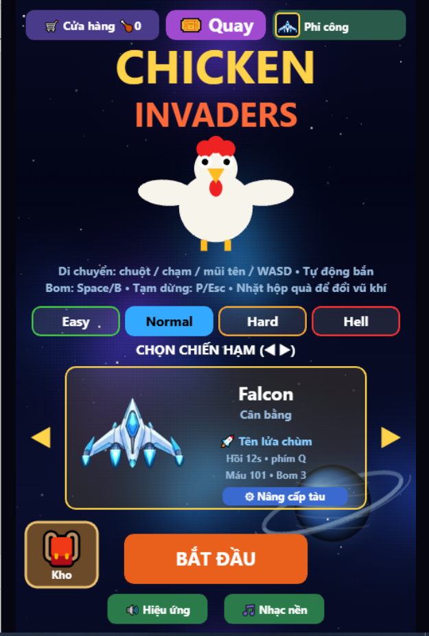

# 🐔 Chicken Invaders – Bắn Gà

Game bắn gà vũ trụ chạy ngay trên trình duyệt, viết bằng **HTML5 Canvas** và **JavaScript thuần**, không dùng thư viện hay framework nào. Toàn bộ game gói gọn trong **một file `index.html`**.

### 🎮 [Chơi ngay tại đây](https://huydlogan.github.io/chicken-invaders/)

---

## ✨ Tính năng

- 🚀 **8 chiến hạm** với chỉ số và vũ khí riêng
- 👾 **Boss khổng lồ** xuất hiện theo từng màn
- 🎁 **Hộp quà** rơi ra để đổi và nâng cấp vũ khí
- 💣 **Bom** dọn sạch màn hình khi bị vây
- 🛒 **Cửa hàng, vòng quay may mắn và kho đồ** để mở khóa skin và nâng cấp
- ⚔️ **4 độ khó**: Easy, Normal, Hard, Hell
- 📱 Chơi được cả trên **máy tính và điện thoại** (điều khiển bằng chạm)

## 🕹️ Cách chơi

| Thao tác | Máy tính | Điện thoại |
|---|---|---|
| Di chuyển | Chuột, phím mũi tên hoặc WASD | Chạm và kéo |
| Bắn | Tự động | Tự động |
| Thả bom | `Space` hoặc `B` | Nút bom |
| Tạm dừng | `P` hoặc `Esc` | — |

Nhặt hộp quà rơi ra từ gà để đổi vũ khí. Sống sót càng lâu, điểm càng cao!

## 🛠️ Công nghệ sử dụng

- **HTML5 Canvas**: vẽ toàn bộ đồ họa và hiệu ứng
- **JavaScript (ES6)**: logic game, va chạm, điều khiển
- **CSS**: căn chỉnh khung game theo kích thước màn hình
- Hình ảnh nhúng trực tiếp dạng **base64 (WebP)** để game chỉ cần một file duy nhất
- Triển khai miễn phí bằng **GitHub Pages**

## 🚀 Chạy trên máy của bạn

Không cần cài đặt gì cả:

1. Tải file `index.html` về máy (bấm vào file → nút **Download raw file**)
2. Mở file bằng trình duyệt (Chrome, Edge, Firefox…)

## 👤 Tác giả

**Trần Quang Huy** – [@Huydlogan](https://github.com/Huydlogan)

---

> Đây là dự án cá nhân làm để học lập trình, lấy cảm hứng từ series game *Chicken Invaders* của InterAction studios. Dự án không có mục đích thương mại và không liên kết với nhà phát triển gốc.
